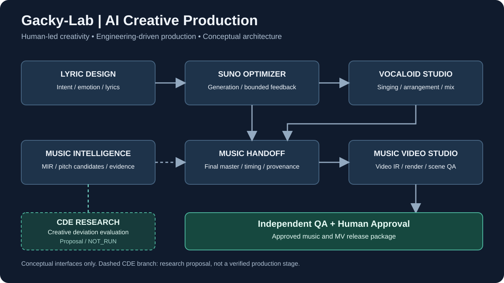

# Gacky-Lab

### Human-led creativity. Engineering-driven production.
**感性は人間に。検証はシステムに。**

Independent research and engineering for reproducible AI music and music video production — bringing requirements engineering, manufacturing quality assurance and software automation into the creative process.

[**Research portfolio**](#research-portfolio) · [**Watch the demo**](#verified-demo) · [**Engineering evidence**](#engineering-evidence) · [**Development roadmap**](#development-roadmap)

**5 research projects · 5 alpha releases · 14/14 synthetic integration and technical checks passed**

## Verified demo

**[Watch / download the 30-second MP4](https://github.com/Gacky-Lab/AI-MUSIC-VIDEO-STUDIO/releases/download/v0.1.0-alpha/synthetic-japanese-preview.mp4)** · [Release and verification reports](https://github.com/Gacky-Lab/AI-MUSIC-VIDEO-STUDIO/releases/tag/v0.1.0-alpha)

1920 × 1080 · 30 fps · Remotion + Python + FFmpeg · Generated in GitHub Actions.

This is a **synthetic technical demonstration**, not a finished musical work. Actual lyric, MIR and video preparation implementations were connected; original synthetic audio and Japanese demonstration captions were used. No paid generation API was used for this demo.

## Research portfolio

| Project | Research focus | Research release |
|---|---|---|
| [LYRIC-DESIGN-FRAMEWORK](https://github.com/Gacky-Lab/LYRIC-DESIGN-FRAMEWORK) | Emotion, lyric design, editorial evaluation, versioned handoff | [v0.1.0-alpha](https://github.com/Gacky-Lab/LYRIC-DESIGN-FRAMEWORK/releases/tag/v0.1.0-alpha) |
| [SUNO-GENERATION-OPTIMIZER](https://github.com/Gacky-Lab/SUNO-GENERATION-OPTIMIZER) | Suno MCP, bounded feedback, independent audio QA | [v0.2.0-alpha](https://github.com/Gacky-Lab/SUNO-GENERATION-OPTIMIZER/releases/tag/v0.2.0-alpha) |
| [AI-MUSIC-INTELLIGENCE-ENGINE](https://github.com/Gacky-Lab/AI-MUSIC-INTELLIGENCE-ENGINE) | Music information retrieval, signal analysis, evidence contracts | [v0.1.0-alpha](https://github.com/Gacky-Lab/AI-MUSIC-INTELLIGENCE-ENGINE/releases/tag/v0.1.0-alpha) |
| [AI-VOCALOID-STUDIO](https://github.com/Gacky-Lab/AI-VOCALOID-STUDIO) | Song IR, vocal synthesis, MIDI and DAW workflows | [v0.1.0-alpha](https://github.com/Gacky-Lab/AI-VOCALOID-STUDIO/releases/tag/v0.1.0-alpha) |
| [AI-MUSIC-VIDEO-STUDIO](https://github.com/Gacky-Lab/AI-MUSIC-VIDEO-STUDIO) | Lyric synchronization, programmatic editing, rendering, video QA | [v0.1.0-alpha](https://github.com/Gacky-Lab/AI-MUSIC-VIDEO-STUDIO/releases/tag/v0.1.0-alpha) |

All releases are research previews, not production-ready products.

## System architecture

The architecture shows the intended production system. It is not a claim that every connection is operational. Suno-only and VOCALOID/DAW paths are both research targets.

## Engineering evidence

| Evidence | Result | Boundary |
|---|---|---|
| [Three-repository contract test](https://github.com/Gacky-Lab/AI-MUSIC-VIDEO-STUDIO/actions/runs/45543144307) | 7/7 PASS | Synthetic data; actual pinned upstream code |
| [Japanese lyric MV integration](https://github.com/Gacky-Lab/AI-MUSIC-VIDEO-STUDIO/actions/runs/45543328049) | 14/14 technical checks PASS | 7 contract, 4 stream/audio, 3 regression checks; not perceptual evaluation |
| [MIR offline CI](https://github.com/Gacky-Lab/AI-MUSIC-INTELLIGENCE-ENGINE/actions/runs/45542408140) | 8/8 tests on Python 3.11 and 3.13 | Synthetic WAV analysis; pulse rate is not verified musical BPM |
| [Suno optimizer](https://github.com/Gacky-Lab/SUNO-GENERATION-OPTIMIZER) | Authorized generation and recorded pilot experiments | Optimization superiority and autonomous paid execution unproven |
| [VOCALOID7 trial draft PR](https://github.com/Gacky-Lab/AI-VOCALOID-STUDIO/pull/1) | Owner-reported 10-second native asa synthesis PoC on Windows | Not independently reproduced; draft, not included in alpha release |
| [Lyric design quality CI](https://github.com/Gacky-Lab/LYRIC-DESIGN-FRAMEWORK/actions/runs/45542448069) | PASS | Offline checks, not listener validation |

### Engineering principles

- Traceable requirements, versioned data contracts and independent verification.
- Separate technical correctness, provider feedback and human artistic judgement.
- Bound paid operations; reconcile uncertain submissions before retrying.
- Preserve negative results and explicit UNKNOWN / NOT_RUN states.
- Keep private media and credentials out of public repositories.

## Development roadmap

- [x] Five research projects and initial alpha releases.
- [x] Synthetic music analysis and 30-second video rendering.
- [x] Three-repository Japanese synthetic integration verification.
- [ ] Authorized real-song preview, human review and Windows reproduction — [tracking issue](https://github.com/Gacky-Lab/AI-MUSIC-VIDEO-STUDIO/issues/6).
- [ ] Real-song beat/pitch analysis and annotated accuracy evaluation — [tracking issue](https://github.com/Gacky-Lab/AI-MUSIC-INTELLIGENCE-ENGINE/issues/2).
- [ ] Faithful vocal reconstruction, full-length music video and end-to-end verification.
- [ ] Independent third-party reproduction and controlled comparison.

## 日本語

Gacky-Labは、製造業の生産技術・品質保証・要求定義の考え方をAI音楽制作に応用する個人研究プロジェクトです。歌詞設計、Sunoによる生成、音楽解析、VOCALOID、MV制作を独立した工程として設計し、再現可能な制作基盤を目指しています。現時点では合成素材による技術検証が中心であり、実楽曲の一貫自動制作や芸術的品質の向上は未実証です。

Independent personal research. Not affiliated with Suno, Yamaha, Crypton, Remotion or other providers. No blanket reuse license is granted; third-party terms apply.
