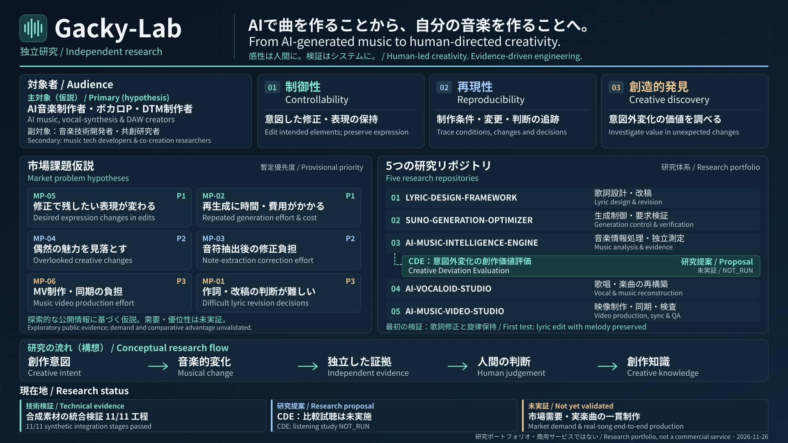

# Gacky-Lab

### From AI-generated music to human-directed creativity.
**AIで曲を作ることから、自分の音楽を作ることへ。**

Human-led creativity. Evidence-driven engineering.  
感性は人間に。検証はシステムに。

Gacky-Lab is an independent research initiative for music creators who want to refine AI-generated music into their own artistic expression. We investigate how creators can reflect their intentions, preserve the musical expressions they value, make production decisions traceable, and discover value in unexpected changes.

Gacky-Labは、AIで生成した音楽を自分の表現として作り込みたいクリエイターのための独立研究プロジェクトです。創作意図の反映、気に入った音楽表現の保持、制作工程・判断の追跡、意図外変化に潜む創作価値の発見を研究します。

[**Research portfolio / 研究一覧**](#research-portfolio) · [**CDE**](#creative-deviation-evaluation-cde) · [**Watch the demo / デモ**](#verified-demo) · [**Engineering evidence / 検証実績**](#engineering-evidence) · [**Development roadmap / 開発計画**](#development-roadmap)

## Research at a glance / 研究全体像

[Full-size SVG / 拡大表示](assets/profile-infographic.svg) · [Editable HTML / 編集用原本](assets/profile-infographic.html) (download and open locally / 保存してブラウザで表示).

The overview summarizes the research direction and evidence boundaries; it does not claim validated market demand or completed production capabilities. / 研究方針と検証範囲の概要図です。市場需要や実楽曲の一貫制作を実証済みとするものではありません。

## Who and why / 誰の何を解決するのか

**Primary audience / 主対象（仮説）:** Independent AI music creators and vocal-synthesis/DAW producers who want to refine specific musical expressions rather than simply accept a generated track.  
生成結果をそのまま採用するだけでなく、気に入った旋律・歌詞・歌唱・編曲を自分で修正したい個人AI音楽クリエイター、ボカロP・DTM制作者。

**Secondary audience / 副対象:** Music technology developers and human–AI co-creation researchers.  
音楽技術開発者、人間とAIの共創を研究する研究者。

| Research challenge / 研究課題 | Intended creator value / 目指す価値 |
|---|---|
| **Controllability / 制御性** | Revise intended elements while preserving desired expressions. / 変更したい箇所を修正し、気に入った表現を保持する。 |
| **Reproducibility / 再現性** | Trace inputs, edits, decisions and evidence across production steps. / 制作条件・変更・判断・検証証拠を追跡する。 |
| **Creative discovery / 創造的発見** | Identify potentially valuable unexpected changes and investigate their reuse. / 偶然の変化から創作価値を見いだし、再利用可能性を調べる。 |

## Market hypotheses / 市場課題仮説

Exploratory public user feedback, existing product capabilities and research motivate these hypotheses. They are not representative market measurements or validated customer requirements. Existing tools already address parts of these problems; comparative benefits remain to be tested.

公開ユーザーの声・既存製品の機能・関連研究に基づく探索的な課題仮説です。市場全体の需要や顧客要求を確認済みとするものではありません。既存手段で解決できる範囲も考慮し、優位性は比較検証します。

| ID | Problem hypothesis / 課題仮説 | Research / 対応研究 | Proposed validation / 効果検証案 | Priority / 暫定優先度 |
|---|---|---|---|---|
| MP-05 | Desired expressions change during edits / 修正時に残したい表現まで変わる | Vocaloid Studio, MIR, CDE | Preservation accuracy, edit time, creator preference / 保持精度・修正時間・本人の選好 | P1 |
| MP-02 | Repeated generation consumes time and credits / 再生成に時間・費用がかかる | Suno Optimizer | Time and credits per acceptable candidate at matched requirements / 同一要求での採用候補あたり時間・費用 | P1 |
| MP-04 | Valuable changes may be overlooked / 偶然の魅力を見落とす | CDE | Restoration comparisons and later reuse study / 復元比較・後続創作での再利用検証 | P2 |
| MP-03 | Extracted notes require correction / 音符抽出後の修正負担 | MIR, Vocaloid Studio | Annotated note accuracy and correction time / 音符精度・修正時間 | P2 |
| MP-06 | Music video production requires manual work / MV制作・同期の負担 | Music Video Studio | Timing error, editing time, human review / 同期誤差・作業時間・人の確認 | P3 |
| MP-01 | Lyric revision lacks clear criteria / 作詞・改稿の判断が難しい | Lyric Design | Revision effort and creator assessment / 改稿工数・作者の評価 | P3 |

Priority is a provisional research decision, not a ranking of market size. / 優先度は暫定的な研究判断であり、市場規模の順位ではありません。

**Research evidence / 調査・検証の正本:** [Market evidence and counterexamples / 市場の声・反証](docs/market-research/MARKET_EVIDENCE.md) · [Related projects / 既存手段](docs/market-research/RELATED_PROJECTS.md) · [Requirements traceability and validation / 要求・検証](docs/governance/RESEARCH_TRACEABILITY.md) · [Current status / 研究状態](docs/governance/RESEARCH_STATUS.md).

**First validation scenario / 最初の検証シナリオ:** Change a short lyric phrase while preserving the melody or another explicitly specified expressive element. Compare with available editing methods using authorized material, matched conditions, and creator review. / 短い歌詞を修正しながら指定した旋律・表現を保持できるか、自作・許諾済み素材を用いて既存手段と比較する。統制不能な場合は複合比較として扱う。

## Creative Deviation Evaluation (CDE)

**[CDE v0.1 — research proposal / 研究提案](https://github.com/Gacky-Lab/AI-MUSIC-INTELLIGENCE-ENGINE/tree/main/research/creative-deviation-evaluation)**

Accepted works may contain unwanted changes; rejected works may contain desirable expressions. CDE separates whole-artifact adoption from preference for a specific unintended change using prospective intent records, controlled restoration comparisons and delayed reassessment.

採用曲にも戻したい変化があり、不採用曲にも残したい表現があるかもしれません。CDEは作品全体の採否と個別変化の選好を分離し、事前の意図記録・復元比較・後日の再評価によって調べる研究提案です。

[View the one-page overview / ワンページ図版](https://github.com/Gacky-Lab/AI-MUSIC-INTELLIGENCE-ENGINE/blob/main/research/creative-deviation-evaluation/README.md). CDE belongs to AI-MUSIC-INTELLIGENCE-ENGINE, not a sixth project. Empirical validation: NOT_RUN. / 実証前であり、学術的優先性・効果を主張しません。

## Current evidence / 現在の検証状況

**5 research projects · Five-repository synthetic integration · 11/11 stages passed**

This is a research portfolio, not a production-ready service. User demand, comparative effectiveness, artistic quality and full real-song production remain unvalidated. / 研究ポートフォリオであり、完成した商用サービスではありません。需要の代表性・比較優位・芸術的品質・実楽曲の一貫制作は未実証です。

## Verified demo

**[Watch / download the 30-second MP4](https://github.com/Gacky-Lab/AI-MUSIC-VIDEO-STUDIO/releases/download/v0.1.0-alpha/synthetic-japanese-preview.mp4)** · [Release and verification reports](https://github.com/Gacky-Lab/AI-MUSIC-VIDEO-STUDIO/releases/tag/v0.1.0-alpha)

1920 × 1080 · 30 fps · Remotion + Python + FFmpeg · Generated in GitHub Actions.

This is a **synthetic technical demonstration**, not a finished musical work. Actual lyric, MIR and video preparation implementations were connected; original synthetic audio and Japanese demonstration captions were used. No paid generation API was used for this demo.

## Latest integration milestone

[Five-repository integration runner](https://github.com/Gacky-Lab/AI-MUSIC-VIDEO-STUDIO/blob/main/docs/FIVE_REPO_INTEGRATION.md) · [Verified expanded CI](https://github.com/Gacky-Lab/AI-MUSIC-VIDEO-STUDIO/actions/runs/45547270779) · [Permanent alpha release and evidence](https://github.com/Gacky-Lab/AI-MUSIC-VIDEO-STUDIO/releases/tag/v0.2.0-alpha)

Actual pinned lyric, Suno proposal, MIDI, MIR and video code was exercised in one synthetic workflow. All eleven runner stages passed; host and network-disabled Docker artifact hashes matched. On the controlled synthetic fixture, 309/309 eligible pitch frames were within 35 cents, all 60 candidate note pitches matched in order, and maximum onset error was 35 ms. The resulting 30-second synthetic MP4 passed seven independent render/audio checks.

[Local browser console](https://github.com/Gacky-Lab/AI-MUSIC-VIDEO-STUDIO/blob/main/docs/LOCAL_CONSOLE.md) · [Coverage evidence](https://github.com/Gacky-Lab/AI-MUSIC-VIDEO-STUDIO/actions/runs/45548022408) (runner 182/182 lines and 13/14 branches; combined scripts 284/536 lines and 42/70 branches) · [Security evidence](https://github.com/Gacky-Lab/AI-MUSIC-VIDEO-STUDIO/actions/runs/45547458355) (zero known dependency findings in scanned sets; 24 LOW static warnings).

The Suno transaction is simulated; the audio comes from a simple synthesizer driven by extracted MIDI notes, not Suno or VOCALOID singing. Real-song and human artistic acceptance remain NOT_RUN.

## Research portfolio

| Project | Research focus | Research release |
|---|---|---|
| [LYRIC-DESIGN-FRAMEWORK](https://github.com/Gacky-Lab/LYRIC-DESIGN-FRAMEWORK) | Emotion, lyric design, editorial evaluation, versioned handoff | [v0.1.0-alpha](https://github.com/Gacky-Lab/LYRIC-DESIGN-FRAMEWORK/releases/tag/v0.1.0-alpha) |
| [SUNO-GENERATION-OPTIMIZER](https://github.com/Gacky-Lab/SUNO-GENERATION-OPTIMIZER) | Suno MCP, bounded feedback, independent audio QA | [v0.2.0-alpha](https://github.com/Gacky-Lab/SUNO-GENERATION-OPTIMIZER/releases/tag/v0.2.0-alpha) |
| [AI-MUSIC-INTELLIGENCE-ENGINE](https://github.com/Gacky-Lab/AI-MUSIC-INTELLIGENCE-ENGINE) | Music information retrieval, signal analysis, evidence contracts; CDE research proposal | [v0.1.0-alpha](https://github.com/Gacky-Lab/AI-MUSIC-INTELLIGENCE-ENGINE/releases/tag/v0.1.0-alpha) |
| [AI-VOCALOID-STUDIO](https://github.com/Gacky-Lab/AI-VOCALOID-STUDIO) | Song IR, vocal synthesis, MIDI and DAW workflows | [v0.1.0-alpha](https://github.com/Gacky-Lab/AI-VOCALOID-STUDIO/releases/tag/v0.1.0-alpha) |
| [AI-MUSIC-VIDEO-STUDIO](https://github.com/Gacky-Lab/AI-MUSIC-VIDEO-STUDIO) | Lyric synchronization, programmatic editing, rendering, video QA | [v0.2.0-alpha](https://github.com/Gacky-Lab/AI-MUSIC-VIDEO-STUDIO/releases/tag/v0.2.0-alpha) |

All releases are research previews, not production-ready products.

## System architecture

The architecture shows the intended production system. It is not a claim that every connection is operational. Suno-only and VOCALOID/DAW paths are both research targets. The dashed CDE branch is a research proposal, not a verified production stage. / 破線のCDEは研究提案であり、検証済み工程ではありません.

## Engineering evidence

| Evidence | Result | Boundary |
|---|---|---|
| [Three-repository contract test](https://github.com/Gacky-Lab/AI-MUSIC-VIDEO-STUDIO/actions/runs/45543144307) | 7/7 PASS | Synthetic data; actual pinned upstream code |
| [Japanese lyric MV integration](https://github.com/Gacky-Lab/AI-MUSIC-VIDEO-STUDIO/actions/runs/45543328049) | 14/14 technical checks PASS | 7 contract, 4 stream/audio, 3 regression checks; not perceptual evaluation |
| [MIR offline CI](https://github.com/Gacky-Lab/AI-MUSIC-INTELLIGENCE-ENGINE/actions/runs/45542408140) | 8/8 tests on Python 3.11 and 3.13 | Synthetic WAV analysis; pulse rate is not verified musical BPM |
| [Suno optimizer](https://github.com/Gacky-Lab/SUNO-GENERATION-OPTIMIZER) | Authorized generation and recorded pilot experiments | Optimization superiority and autonomous paid execution unproven |
| [VOCALOID7 trial draft PR](https://github.com/Gacky-Lab/AI-VOCALOID-STUDIO/pull/1) | Owner-reported 10-second native asa synthesis PoC on Windows | Not independently reproduced; draft, not included in alpha release |
| [Lyric design quality CI](https://github.com/Gacky-Lab/LYRIC-DESIGN-FRAMEWORK/actions/runs/45542448069) | PASS | Offline checks, not listener validation |

### Engineering principles

- Traceable requirements, versioned data contracts and independent verification.
- Separate technical correctness, provider feedback and human artistic judgement.
- Bound paid operations; reconcile uncertain submissions before retrying.
- Preserve negative results and explicit UNKNOWN / NOT_RUN states.
- Keep private media and credentials out of public repositories.

## Development roadmap

- [x] Five research projects and initial alpha releases.
- [x] Synthetic music analysis and 30-second video rendering.
- [x] Three-repository Japanese synthetic integration verification.
- [ ] Authorized real-song preview, human review and Windows reproduction — [tracking issue](https://github.com/Gacky-Lab/AI-MUSIC-VIDEO-STUDIO/issues/6).
- [x] Monophonic pitch and review-only note candidate baselines; synthetic tests passed.
- [x] Timestamped transcript to review-only lyric timing candidates; synthetic tests passed.
- [x] Five-repository offline integration and Docker reproducibility.
- [ ] Real-song beat/pitch analysis and annotated accuracy evaluation — [tracking issue](https://github.com/Gacky-Lab/AI-MUSIC-INTELLIGENCE-ENGINE/issues/2).
- [ ] Faithful vocal reconstruction, full-length music video and end-to-end verification.
- [ ] Validate MP-05 with authorized controlled edit comparisons and creator feedback. / 表現保持の比較検証。
- [ ] Validate MP-02 with matched requirements and cost/time measurements. / 再生成負担の比較検証。
- [ ] CDE controlled listening study and delayed reassessment (NOT_RUN). / CDE試聴実験。
- [ ] Independent third-party reproduction and controlled comparison.

## 日本語

Gacky-Labは、製造業の生産技術・品質保証・要求定義の考え方をAI音楽制作に応用する個人研究プロジェクトです。歌詞設計、Sunoによる生成、音楽解析、VOCALOID、MV制作を独立した工程として設計し、再現可能な制作基盤を目指しています。現時点では合成素材による技術検証が中心であり、実楽曲の一貫自動制作や芸術的品質の向上は未実証です。

Independent personal research. Not affiliated with Suno, Yamaha, Crypton, Remotion or other providers. No blanket reuse license is granted; third-party terms apply.
