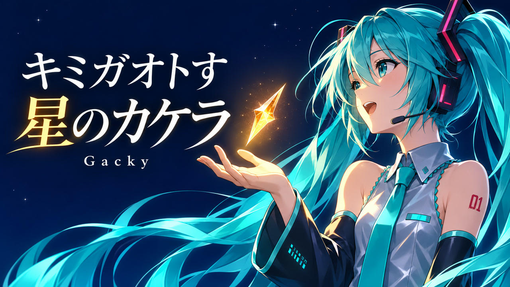

# キミガオトす星のカケラ

星空を見上げた君の手のひらに、ひとつの光が落ちてくる。
「キミガオトす星のカケラ」を、初音ミクが踊る3Dミュージックビデオにしました。

サビでは「キミガオトす」と「星のカケラ」が画面の両側から飛び込みます。間奏ではミクが歩みを止め、夜空の光にそっと手を伸ばします。

## 振付とカメラの見どころ

- **0:11　手のひらに落ちた光**　ミクが両手を持ち上げるところでカメラを少し引き、手と顔を一緒に映します。「胸に刻んで」で表情に寄ります。
- **0:28　サビ**　左右から入る歌詞は「キミガオトす」が先に着地します。次に「星のカケラ」が並び、ひと続きの曲名として読める時間を取っています。
- **0:50　最初の間奏**　歩くミクを横から追い、足が止まったところでカメラを寄せます。視線の先を追うように、手が星へ伸びていきます。

## クレジット

- 楽曲　Gacky（Suno）
- 振付・映像制作　Gacky-lab
- 出演キャラクター　初音ミク © Crypton Future Media, INC.
- 3Dモデル　初音ミク ver.2.3（MikuMikuDance付属）
- モデリング・データ変換　あにまさ氏

初音ミクの非公式ファン作品です。

[Sunoで原曲を聴く](https://suno.com/s/OXJquu8gQMIdyYYb) ／ [ピアプロ・キャラクター・ライセンス](https://piapro.jp/license/pcl)
