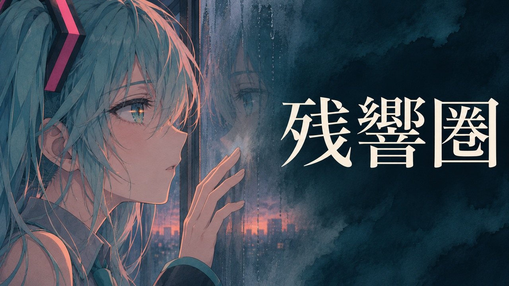

# 残響圏

> ここにいるよって言えない

ぬるいマグを両手で持ったまま、ミクは午後の窓を見ている。会いたい相手にひと言を送れず、部屋には朝の光が差す。Gackyの楽曲『残響圏』に、Gacky-labが初音ミクを主人公とするアニメーションを制作しました。[Sunoで原曲を聴く](https://suno.com/s/YXNHR4bVMSFoObZs)

## 歌詞から生まれた三つのカット

- **1:20　敷居**　ドアのレバーに指を掛け、つま先に一度だけ体重を乗せる。「ドアを開けて　閉めないまま」と歌い出す直前に、足は部屋へ戻ります。
- **2:38　曇りガラス**　指で「き」と書きかけ、自分で消す。文字の消えた窓に少しとどまってから、「心は割れないガラスみたいで」へつなぎました。
- **3:18　言えない**　「ここにいるよって」で唇が開き、ひと呼吸遅れて「言えない」の文字が現れます。視線が落ちるまでをひとつのカットにしました。

## クレジット

- 楽曲　Gacky（Sunoで制作）
- 映像・演出・編集　Gacky-lab
- 映像制作　AI生成原画、動きの補間、歌詞に合わせた編集
- 登場キャラクター　初音ミク © Crypton Future Media, INC.
